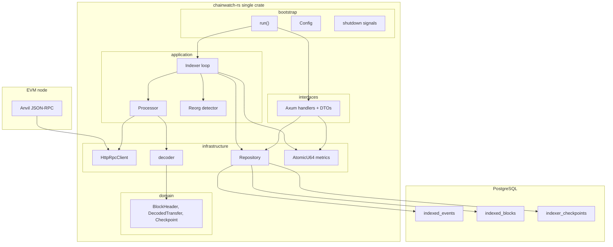

# Architecture overview

This document explains how `chainwatch-rs` is designed and implemented,
detailing its ingestion pipeline, persistence guarantees, and reorganization handling.

If you have built a job that polls an HTTP API, writes to Postgres, and exposes
a REST endpoint, you already understand the shape of this service. The new
parts are: Ethereum's log format, chain reorganizations, and Rust's approach
to async concurrency.

Companion docs:

- [Indexing pipeline](indexing-pipeline.md)
- [Persistence](persistence.md)
- [Reorg handling](reorg-handling.md)
- [ADR: single-crate layered architecture](../adr/0001-single-crate-layered-architecture.md)

## Why an indexer exists

Wallets, analytics products, and exchange backends cannot scan the chain from
scratch on every user request. An indexer turns append-only blockchain data
into queryable rows: "show me every ERC-20 transfer involving this address."

That is the same reason you would ETL Stripe webhooks into a `payments` table
instead of calling Stripe on every page load.

## High-level diagram



## Layers and dependency direction

| Layer | Owns | Must not depend on |
| --- | --- | --- |
| `domain` | Blockchain types, hex helpers, `AppError` | Axum, SQLx, reqwest |
| `application` | Indexing loop, pipeline, reorg planning, ports | HTTP routers, SQL text |
| `infrastructure` | RPC, retry, decoder, Postgres, tracing, metrics | Axum handlers |
| `interfaces` | Router, handlers, DTOs, API errors | Indexer internals |
| `bootstrap` | Env config, pool, migrations, wiring, shutdown | — |

`src/main.rs` only calls `chainwatch_rs::run()`. Integration tests import the
library crate.

Node.js analogue: keep `types.ts` free of Express and `pg`; put SQL in a
repository; put Express handlers in `routes/`; start the process in `index.ts`.

## Component map

| Module | Responsibility | Node.js analogue |
| --- | --- | --- |
| `bootstrap/config.rs` | Typed `process.env` with fail-fast validation | `envalid` / `zod` on env |
| `infrastructure/blockchain/rpc_client.rs` | JSON-RPC HTTP client | `ethers.JsonRpcProvider` |
| `infrastructure/blockchain/decoder.rs` | ABI-decode ERC-20 `Transfer` logs | `iface.parseLog` |
| `application/indexing/pipeline.rs` | Bounded concurrent fetches | `p-limit` + `Promise.all` |
| `application/indexing/service.rs` | Poll loop, range planning, ordered writes | cron / `setInterval` worker |
| `infrastructure/persistence/repository.rs` | SQL, transactions, idempotent inserts | `pg` + `BEGIN/COMMIT` |
| `application/indexing/reorg.rs` | Canonical-hash comparison and rollback plan | compensating transaction |
| `interfaces/http/` | Health, status, events, metrics | Express / Fastify routes |
| `infrastructure/telemetry/metrics.rs` | Atomic counters | Prometheus client |
| `bootstrap/shutdown.rs` | SIGINT / SIGTERM | `AbortController` + signal |

## RPC ingestion

The production client is `HttpRpcClient`. It implements the `ChainReader` port
and speaks Ethereum JSON-RPC over HTTP with `reqwest` + rustls:

1. `eth_chainId` — refuse to start if it does not match `CHAIN_ID`.
2. `eth_blockNumber` — observe the tip.
3. `eth_getLogs` — pull ERC-20 `Transfer` logs for a block range.
4. `eth_getBlockByNumber` — headers for hash, parent hash, and timestamp.

Tests implement `ChainReader` with an in-memory map of blocks.

Retry uses exponential backoff (`100ms`, `200ms`, … capped at 2s) and a
per-attempt timeout. Transient node failures increment `rpc_request_failures`
and `retry_count`.

## Confirmation depth and safe head

```
safe_head = latest_block - CONFIRMATION_DEPTH
```

If `latest` is 100 and depth is 12, the indexer only writes through block 88.
Depth `0` is correct for a local Anvil demo.

## Error handling

Rust's `Result<T, E>` is not an exception. `AppError` lives in `domain` and
does not import SQLx or reqwest; infrastructure maps driver errors into
`Database` / `Http` strings. `anyhow` is used only at the binary edge.

The indexer loop logs a failed tick and continues. The checkpoint does not
advance on failure, so blocks are not skipped.

## Operational metrics

`Metrics` holds `AtomicU64` counters. `/metrics` returns JSON by default and
Prometheus text if the client sends `Accept: text/plain`. Labels never include
wallet addresses or transaction hashes.

## Security considerations

- Anvil private keys in the demo scripts are **public test keys**.
- `DATABASE_URL` passwords are redacted in startup logs.
- SQL is parameterized.
- The HTTP API is read-only.
- Bind `API_HOST=127.0.0.1` locally. `0.0.0.0` is for Docker.
- Amounts are decimal strings, not floats.
- A session-level PostgreSQL advisory lock prevents two indexers on one chain.

## Design tradeoffs

| Choice | Why | Cost |
| --- | --- | --- |
| Single crate, layered modules | One binary, one lockfile, tests import the lib | Not independently versioned libraries |
| HTTP JSON-RPC via `reqwest` instead of Alloy provider | Smaller, mockable surface | No websocket subscriptions |
| Runtime SQL (`query_as`) not `query!` macros | `cargo build` works without a live database | No compile-time SQL checking |
| Per-block transactions | Simple crash semantics | Slightly more round-trips |
| Polling instead of `eth_subscribe` | Works with every HTTP RPC, including Anvil | Extra latency up to `POLL_INTERVAL_MS` |
| In-process metrics | Zero extra infrastructure | Lost on process restart |

These are MVP choices. A production indexer at scale would add cursor-based
pagination, per-chain workers, a metrics sidecar, and a websocket head
follower behind the confirmation buffer.
